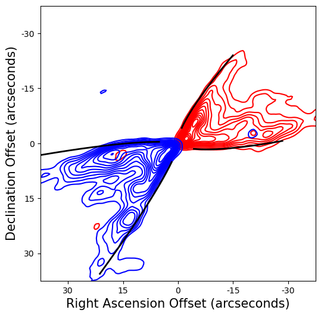

# Looking Curvy: Tracing Curved Protostellar Outflows

  

## What is it?

This code traces the boundary of protostellar outflows and fits power laws to those detected boundaries to trace the curved morphology of some protostellar outflows.

**CurveTracer.ipynb** contains all the code needed to trace and fit protostellar outflows.

**Test_Data** contains two sample FITS files: one with a redshifted outflow and one with a blueshifted outflow, both from Per-emb 5. These are the only two data files needed to test the code.

**bothfit.png** shows the fits expected from the provided Fits files.

## How do I install it?

Just download the repository; the Jupyter notebook contains all required installation code.

## How do I use it?

With great responsibility. The entire codebase is in a Jupyter notebook. Run each cell in the notebook.

**How to load test files:** For the test data, the file paths are: "Test_data/...". The first cell of Chapter 2 in the notebook loads these.

**How to load other files:** The code expects standard FITS files. Simply replace the test redshifted and blushifted FITS files first cell of Chapter 2 in the notebook with the names of your new files.
